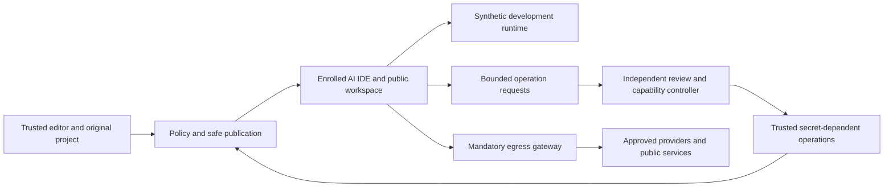

# Project privacy architecture for normal and AI-assisted coding

Date: 2026-10-12. Status: target design for incremental local implementation; deployment DEFERRED. Full G1-G6 claim BLOCKED. This document does not supersede historical evidence or mark Phase 3 assertions as tested.

## Product contract and evidence

**INFERENCE / design decision:** ordinary editing, searching, builds, tests and previews should operate freely on deliberately published project content. Protected original values stay outside the agent's authority. Approval concerns a new data publication or a capability expansion, rather than repeated access to already-public content. Secret-free development uses working synthetic configuration, fixtures and disposable development services. Mock results must be identified; they do not establish production parity.

**FACT (local report inspected 2026-10-12):** the current implementation supplies masked, reviewed views through SoterAI commands and its fixed reader terminal. Cline's own tools, ordinary terminals, original editor buffers and independent network requests are outside that boundary. See [implementation report](IMPLEMENTATION-REPORT.md). The new build has not been installed or loaded into a live editor.

**FACT (primary documentation checked 2026-10-12):** VS Code's extension host shares the editor's permissions and permits file access, process launch and network requests. [Microsoft runtime security](https://code.visualstudio.com/docs/configure/extensions/extension-runtime-security).

**FACT (primary documentation checked 2026-10-12):** Cline documents `.clineignore` as a context filter, not a security boundary. Its published blocking hook ends the current task. [Cline ignore documentation](https://docs.cline.bot/customization/clineignore).

**INFERENCE:** an unrestricted sibling extension cannot be forced through SoterAI's reader by adding UI, hooks, a same-user background process or a network scanner. Smooth ordinary workflows need a usable public workspace; rogue-agent confidentiality additionally requires independently enforced isolation.

## ADR-EP01: one privacy core, explicit deployment modes

**INFERENCE / context:** the owner targets Windows 11 Home, VS Code and Cline, and requests low-friction normal and vibe coding. OS/account/VM/firewall/driver changes, purchase and deployment remain outside current authorization.

**INFERENCE / options and decision matrix:** scores are design estimates, 1 = weak and 5 = strong; no score is a verified security result.

| Option | Routine workflow | Potential confidentiality boundary | Home adoption | Independent policy custody | Decision |
|---|---:|---:|---:|---:|---|
| Shared-host extension/hooks only | 4 | 1 | 5 | 1 | Keep bounded managed-reader value; do not advertise isolation |
| Secret-free devcontainer/WSL workspace | 4 | 2 | 4 | 2 | Optional development convenience, not full rogue-agent containment |
| Separate standard account and logon session | 3 | 3 | 3 | 3 | Home-compatible partial model to verify later |
| Separately managed whole-IDE VM and independent controller | 3 | 4 | 2 | 4 | Retain strong isolation reference; deployment deferred |
| Full Phase 3 authority, presence and continuity design | 2 | 5 | 1 | 5 | Full-contract reference only; its prerequisites and assertions remain UNTESTED |

**INFERENCE / decision:** share versioned policy, publication, capability and coverage contracts across modes. Expose actual effective mode in the product. Do not silently downgrade a protected launch to unrestricted native execution. Whole AI IDE/UI and tool descendants belong inside the enrolled compartment; protected editing belongs outside it. A second profile alone does not establish this boundary.

**FACT (primary documentation checked 2026-10-12):** WSL is explicitly not a security sandbox for untrusted code. [WSL security model](https://wsl.dev/technical-documentation/security/). Dev Containers can reuse host Git credentials and forward SSH agents. [Microsoft credential sharing](https://code.visualstudio.com/remote/advancedcontainers/sharing-git-credentials). Remote extension APIs retain local clipboard and command/UI bridges. [Microsoft remote extensions](https://code.visualstudio.com/api/advanced-topics/remote-extensions).

**FACT (primary documentation checked 2026-10-12):** the supported Windows Hyper-V role and Windows Sandbox do not support Windows Home. [Hyper-V installation requirements](https://learn.microsoft.com/en-us/windows-server/virtualization/hyper-v/get-started/install-hyper-v), [Windows Sandbox editions](https://learn.microsoft.com/en-us/windows/security/application-security/application-isolation/windows-sandbox/).

**INFERENCE / consequences:** a Home machine can use the partial-account model only after its ACL/session/network behaviour is separately demonstrated. Full isolation may need another supported managed backend or edition; neither is purchased or enabled now. Linux/macOS require their own confinement, identity, IPC, clipboard and networking implementations and evidence; Windows results do not transfer.

## Layer and guarantee responsibilities

All rows are **INFERENCE / target design**, not existing guarantees. G1 = denied protected representations; G2 = exact independent consent; G3 = durable denial; G4 = mandatory egress; G5 = secret custody; G6 = evidenced coverage. See the unchanged [Phase 2 definitions](../secretguard/guarantee-program-2026-10-09/phase2/mechanism-matrix.md) and [Phase 3 assertions](../secretguard/guarantee-program-2026-10-09/phase3/acceptance-criteria.md).

| Layer | Target guarantees | Responsibility and known limit |
|---|---|---|
| Versioned policy core | G1, G3; supports G6 | Retained deny plus sensitive treatment in one record; restrictive merge; malformed state withholds release. Current Memento is same-user storage, not independent custody. |
| Safe publisher | G1, G5 | Publish approved inventory, schemas, contracts and synthetic data. Exclude protected originals, source Git objects, host credentials, recovery files and unsafe aliases. Scanning cannot recognize every unknown secret. |
| Enrolled whole AI runtime | G1, G3, G5 | All Cline tools, shells, browser and MCP delegates use the public view. Native agents outside enrollment remain uncovered. |
| Synthetic development runtime | Supports G1, G5 and usability | Builds/tests/preview use disposable services and fake values. No automatic real-credential fallback; no production-parity claim. |
| Independent controller and consent | G2, G3, G5 | Authority and policy keys outside agent reach. Grants bind authoritative project/item/revision, workload/launch, action, output, destination, lifetime and use count. Current native modal is not agent-proof presence. |
| Trusted operation broker | G1, G2, G5 | Fixed reviewed operations with bounded public output. Arbitrary AI-written code, shell, SQL or debugger receiving real credentials defeats the target separation. |
| Mandatory network enforcement | G4; supports G3 | All applicable IPv4/IPv6, DNS, direct-IP, browser, helper and MCP routes mediated. Destination permission never grants protected content. No enforcement deployment exists now. |
| Coverage, release and audit | G6; supports G3 | Fresh authenticated effective-state evidence, pinned artifacts and metadata-only audit. Editor pixels/process liveness are not proof of protection. |

## ADR-EP02: policy and publication consistency

**INFERENCE / decision:** keep a file's deny and always-masked classification together. Public additive updates cannot weaken classification. Bound safe reads to one immutable policy/content snapshot. Validate and migrate legacy metadata before managed release; retain historical storage for review. Policy signing later requires protected signing authority and rollback continuity; a signature stored beside an agent-readable key is insufficient.

**INFERENCE / rejected alternatives:** separate best-effort deny/tag writes; accepting a missing tag as evidence of ordinary content after a completed migration; defaulting to original content on storage failure; automatic publication based only on file extension; loading an older reader that ignores stronger classification.

## ADR-EP03: smooth development and real-service access

**INFERENCE / decision:** approved public code, schema names and working dummy configuration are repeatedly available without privacy prompts. Keep safe schema and executable dummy configuration distinct. Use fixed, reviewed trusted operations for real services; return explicitly public structured fields. Raw logs, responses, screenshots, browser storage and database rows do not automatically cross back.

**INFERENCE / consent:** agent requests create bounded pending records, not approval ceremonies. The trusted user independently opens authoritative review. Bind a grant to exact item/content/policy revision, enrolled workload/launch, operation, output class, destination, duration and use count. Agent authority excludes signing keys, grant issuance and controller UI automation. Resistance to automation remains UNTESTED until independent presence is evidenced; current editor confirmations cannot claim it.

**INFERENCE / revocation:** serialize the revocation decision before new releases; block subsequent commits. Show "revocation pending" until active authority cancellation/drain is acknowledged. Already released content cannot be recalled. Public coding may continue while an unrelated private operation waits, provided its own prerequisites remain valid.

**INFERENCE / rejected alternatives:** injecting real secrets into arbitrary agent-controlled applications; global session approval for original secret reads; scanner-only egress; unrestricted API/SQL proxies; stopping every ordinary read; pretending mocks reproduce production.

## Professional workflow and acceptance targets

The following are **INFERENCE / future expected results**:

- One guided setup chooses managed or an actually supported enrolled mode, reviews publication and displays Covers / Does not cover before acknowledgement.
- A representative approved public coding/build/test/preview flow has zero extra privacy approval prompts after setup. Measure this with actual pinned Cline routing later; the current per-read reader does not meet this target.
- Approved schema names appear automatically; fake development values run the application. Enrolled original secret values appear in none of the tested AI-visible file, output, browser, history or network surfaces.
- Protected-file contracts remain useful without publishing implementations; confidential implementation editing occurs only in the trusted editor.
- Unknown or sensitive private-side changes hold the affected publication. Do not stop unrelated already-public work or silently release originals.
- Policy/root/content changes, malformed state, revocation, expiry and wrong workload/destination produce no new protected release. A public positive control must still work.
- UI updates on relevant changes, supports filtering/pagination, keyboard and high contrast, and reports unsupported states explicitly. Audit stores decision metadata, never protected plaintext.
- Effective enterprise version policy is checked rather than assumed. **FACT (primary documentation checked 2026-10-12):** VS Code documents version allowlists, administrator precedence and malformed-policy nonapplication. [Enterprise extension policy](https://code.visualstudio.com/docs/enterprise/extensions).

## Incremental roadmap and rollback

Every row is **INFERENCE / planned work**; stop after each implementation step for review, as previously requested.

| Increment | Feature boundary / acceptance | Rollback |
|---|---|---|
| I1: atomic sensitive restriction | One retained rule stores deny + sensitive; migration/failure/concurrency controls; safe public control | Withdraw new safe reads/mutations via dedicated flag; retain strong records and legacy metadata. Do not load an older reader that ignores them. |
| I2: safe-view composition | Protected regions cannot turn multiline dotenv value text into exported names | Withhold ambiguous schemas; retain deny/whole-content masking |
| I3: honest professional UI | Live state, searchable complete restriction inventory, accessible actions, accurate completed/failed feedback | Revert presentation; retain authoritative policy |
| I4: public workspace publisher | Deliberate inventory; bounded, revision-aware export/import; no original history/credentials/unsafe aliases | Stop publishing/sync; retain originals; no original-mount fallback |
| I5: dummy runtime and contracts | Representative public development tasks work without repeated prompts | Remove generated public fixtures only; no real-secret substitution |
| I6: broker and workload capabilities | Exact recipient/revision/action/output/destination/expiry/revocation, positive and negative controls | Stop issuance, cancel/drain leases, keep protected custody |
| I7: independently enforced deployment | Separately authorized OS prerequisites and exact topology/identity/session/network evidence | Backed-up administrative rollback; no automatic unrestricted launch |

**INFERENCE / verification plan:** record source and actual loaded artifact hashes, OS/editor/Cline versions, effective identity/session/launch, policy/content revisions, expected and observed result and working positive controls. Unit/stub results cannot populate the thirty Phase 3 architecture assertions. Preserve A0 and previous reports verbatim. No new probes or exploit scripts are authorized.

**FACT (filesystem inspection 2026-10-12):** only acceptance-criteria.md is presently present under phase3; the other previously referenced Phase 3 documents and phase0/open-issues.json were not found at their stated repository paths. Their missing contents are INCOMPLETE and are not reconstructed as facts.

**INFERENCE / remaining limits:** same-user policy tampering, complete store deletion across restart, unenrolled native agents, prior disclosures/copies, protected buffers/clipboard/capture, administrator compromise, independent consent, mandatory egress, remote delegates and side channels remain outside current verification. Full claim BLOCKED; deployment DEFERRED.

**FACT (2026-10-12 final local scope):** The current local candidate completed the bounded I1?I5 workflows and source-only I6 protocol checks. This supersedes earlier per-turn stop instructions for this authorized run; it does not deploy the I6 authority or I7 OS boundary. Final source/host/visual/agent results and exact omissions are in [FINAL-LOCAL-REPORT.md](FINAL-LOCAL-REPORT.md) and [SCORECARD.md](SCORECARD.md). Full claim remains BLOCKED.
