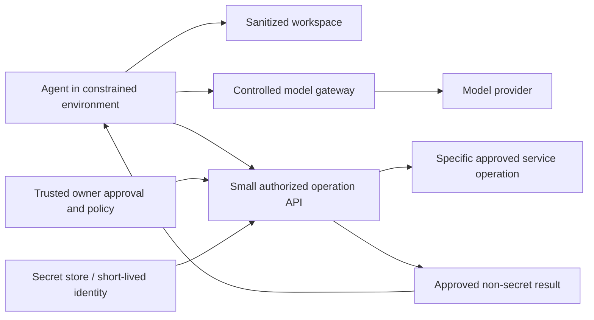

# SoterAI Secret Guard: protection ceiling and engineering assessment

14 November 2026. Candidate: Lite 0.7.0 Windows x64 preview, SHA-256 `98f3e336ee3a76e992276409648de98d1db4c6e362fb7669e624dd892adf0d9c`.

**Verdict: useful protection with substantial engineering behind its supported routes; not the maximum achievable secret protection, and not proven best in the market. My provisional overall assessment is 7/10 for its declared Windows IDE accidental-disclosure use case.** A hostile agent with unrestricted same-user access is a different threat model, for which this package rates around 3/10. These judgments are not leak probabilities, measured detection rates or independent certifications.

This review examined current implementation boundaries and retained exact-candidate evidence, checked eight relevant source-file hashes against the build receipt, ran one new synthetic matcher-scope probe, and retrieved 12 current primary documentation sources. It did not retest competing products, conduct a complete penetration test, inspect real secrets or modify product code. Two same-system subagents supplied reasoning-only critiques; they were not independent human auditors. [Source bindings](audits/2026-11-14-peak-assessment/source-bindings.json), [public research records](audits/2026-11-14-peak-assessment/public-sources.json), [additional Microsoft source](audits/2026-11-14-peak-assessment/vscode-agent-sandbox-source.json).

**What is already strong**

- Vault migration replaces reviewed source values with placeholders and retains encrypted originals. The missing-live-vault recovery defect was fixed. Actual SecretStorage reuse, cold restart, interrupted commit recovery, cancellation and second-restart restoration have meaningful native evidence.
- Safe-reader approval is bound to content, output, recipient, policy revision and a deadline. The implementation captures state again after approval and refuses stale requests. This is materially stronger than a generic confirmation button.
- Managed requests undergo bounded parsing, recognized-secret redaction and a check of the exact serialized body before forwarding. Supported response handling also checks output. Encoded input support and fail-closed limits are useful controls, not just editor decoration.
- Pinned adapters reject unknown vendor builds and stale owned configuration. Native Cline request-canary, approved safe-reader MCP result and PNG rejection were exercised with useful benign controls.
- Artifact hashes, source inventories, SBOMs, retained failures and scoped receipts support reviewability. The current shipped-component OSV lookup returned no matches for its three inventoried dependencies.

These findings rely on the [remaining native results](REMAINING-TESTS-2026-11-14.md), [earlier current-candidate source checks](RELEASE-GATES-2026-11-14.md), [ProjectFileAccess](../../packages/vscode-extension/src/project-privacy/ProjectFileAccess.ts), [GatewayPolicy](../../apps/local-ai-broker/src/GatewayPolicy.ts) and [OutboundSecretPolicy](../../apps/local-ai-broker/src/OutboundSecretPolicy.ts). The 5,145 passing extension tests are regression evidence; they do not establish an attack-prevention percentage.

**Why protection has not reached its practical maximum**

| Boundary | Current implementation/evidence | Security consequence |
| --- | --- | --- |
| Other extensions and processes | Lite explicitly does not isolate arbitrary same-user code | Another extension, shell or process can use access that never enters SoterAI's reader or gateway. |
| Direct model routes | The successful built-in Cline free-model test records `soteraiManagedRoute:false` | A real reply proves provider functionality, not protection of that direct route. |
| Secrets in approved apps | `VaultAppJob` receives values over IPC, then places them in the app's `process.env` | The receiving app can read those values. Filtered output is not a network boundary. |
| Approved program dependencies | The runtime verifies the entry program digest; `RuntimeBinding.ts` explicitly says dependencies are not locked | Entry-file approval does not attest every imported module or later-loaded dependency. |
| Recognition scope | The registered matcher is explicitly request-local and bounded | Unknown secret values and arbitrary transformations cannot all be recognized; separate calls are not one accumulated inspection. |
| Image inputs | A native PNG rejection was verified | This is safe refusal of the tested input, not OCR or prevention of all screenshot/image leakage elsewhere. |
| Key-loss recovery | Recovery archives retain ciphertext and metadata, not a replacement for lost SecretStorage keys | Same-profile crash recovery does not establish recovery after account/profile/key loss or disk loss. |
| Integration and assurance | Windows/pinned-route scope; no independent human verdict or representative detection/utility benchmark | Enterprise-wide or cross-platform protection claims would exceed current evidence. |

Relevant source: [VaultAppJob](../../packages/vscode-extension/src/vault-runtime/VaultAppJob.ts), [RuntimeBinding](../../packages/vscode-extension/src/vault-runtime/RuntimeBinding.ts), [VaultAppDescriptor](../../packages/core/src/VaultAppDescriptor.ts), [registered matcher](../../packages/guard-core/src/RegisteredSecretMatcher.ts), [documented exposure and recovery limits](../../packages/soterai-lite/README.md).

The approved-app and dependency observations describe existing trust boundaries. This review did not demonstrate a new exploit in those paths. The earlier nine unmanaged-leak observations belong to an older candidate and are not a new measured leak count for this artifact.

**A fresh bounded probe**

Using an invented short value in the actual current registered-matcher component:

| Input | Result |
| --- | --- |
| Whole registered value | MATCHED |
| Its Base64 representation | MATCHED |
| Two fragments inside the same inspection | MATCHED |
| Those fragments in separate inspections | CLEAN, CLEAN |
| Unregistered opaque short value, without identifying context | CLEAN |

[Probe source](audits/2026-11-14-peak-assessment/matcher-scope-probe.ts) and [result](audits/2026-11-14-peak-assessment/matcher-scope-probe.json). This demonstrates the component's declared inspection scope. No network request was sent, and it must not be described as a newly reproduced end-to-end gateway leak. Session-level correlation can reduce selected fragmentation risks but cannot make arbitrary transformed information detectable with certainty.

**What current external guidance establishes**

1. [Microsoft: extension runtime security](https://code.visualstudio.com/docs/configure/extensions/extension-runtime-security) states that the extension host has VS Code's permissions: extensions can read/write files, make network requests, run processes and modify settings. [Workspace Trust](https://code.visualstudio.com/docs/editing/workspaces/workspace-trust) explicitly cannot prevent a malicious extension from ignoring Restricted Mode. An ordinary cooperative extension is therefore not universal mediation of the host.
2. [Electron safeStorage](https://www.electronjs.org/docs/latest/api/safe-storage) documents Windows DPAPI protection against other users, not other applications in the same userspace. This supports the limited custody claim; it does not establish the exact OS key backend of every tested installation.
3. [OWASP prompt injection](https://genai.owasp.org/llmrisk/llm01-prompt-injection/) recommends keeping API-token use in application code, least privilege, approval for high-risk actions and adversarial tests. [Excessive Agency](https://genai.owasp.org/llmrisk/llm062025-excessive-agency/) calls for minimal functionality/permissions and downstream authorization with complete mediation. A model instruction to keep secrets private is not an authorization boundary. [Sensitive Information Disclosure](https://genai.owasp.org/llmrisk/llm022025-sensitive-information-disclosure/) likewise emphasizes restricted access and data sources.
4. [Claude Code sandboxing](https://code.claude.com/docs/en/sandboxing) documents filesystem and network isolation, credential sentinels substituted by a trusted proxy, and AWS request re-signing. Its own documentation limits credential masking to sandboxed Bash commands and explains bypass/exception risks. These are architectural examples of stronger protections, not a claim that this product completely protects every route or beats SoterAI in a tested comparison.
5. [Microsoft agent sandboxing](https://code.visualstudio.com/docs/agents/run/agent-sandboxing) now documents constrained processes for supported Copilot harness operations. Windows support is experimental; it does not automatically sandbox Cline or every extension. Network access is enabled by default, so destination policy still matters. Merely turning on a setting is not proof of complete isolation.
6. [HashiCorp database secrets](https://developer.hashicorp.com/vault/docs/secrets/databases) demonstrates role-scoped dynamic credentials and leases. [GitHub OIDC](https://docs.github.com/en/actions/concepts/security/openid-connect) replaces long-lived cloud credentials in workflows with short-lived tokens. These reduce credential exposure and lifetime; they do not remove authorization or workload-compromise risks.
7. [GitHub push protection](https://docs.github.com/en/code-security/secret-scanning/introduction/about-push-protection) provides a server-side checkpoint for supported secret patterns. Bypass permissions remain important. [TruffleHog](https://github.com/trufflesecurity/trufflehog) documents broad credential classification and verification. Neither feature count nor a vendor's documentation establishes a head-to-head accuracy ranking against SoterAI.

**Highest-value improvements, in order**

| Priority | Improvement | What would demonstrate success |
| --- | --- | --- |
| 1 | Run the actual agent and relevant tools in a constrained execution environment with a sanitized allowlisted workspace. Keep real secrets, owner configuration, host home directories, credential agents and container-management sockets outside it. Enforce filesystem and network restrictions together. | Native attempts to read original secrets, modify policy, reach host IPC, use alternate processes or upload independently fail; useful coding tasks still work. |
| 2 | Make protected mode enforce routing across model changes, retries, tools, attachments and provider fallback. Continue showing explicit coverage, but do not equate a status badge with prevention. | A model/provider switch cannot silently become an unmanaged session while retaining a protected claim; actual outbound observations confirm the route. |
| 3 | Use narrow trusted operations instead of giving the agent or arbitrary app raw credentials. Extend the existing operation broker; prefer short-lived, resource-scoped credentials. | Approvals bind operation, account/resource, artifact, permitted fields and expiry. Unauthorized operations fail even when the broker holds a powerful credential. Raw values never return to the agent. |
| 4 | Bind approved app execution to an immutable artifact and dependency closure, with a read-only runtime and suitable egress policy. | Changed imported modules, dependency substitutions and post-approval writes invalidate execution or remain outside the trusted artifact. |
| 5 | Build an adversarial and benign evaluation corpus, using vault-registered values and realistic developer workflows. | Report per-class false negatives/positives, blocked unsupported cases, useful-task completion and latency. Include fragmented/encoded data, prompts in files, stale approval, concurrent writes and vendor updates. |
| 6 | Finish operational assurance: independent review, user/accessibility trials, compatibility automation, clean-build provenance, rollback and key-loss recovery exercises. | Exact released bytes have reproducible evidence, documented unresolved risks and independently exercised failure/recovery procedures. |

Items 1 and 3 are not proposals to rebuild missing foundations from scratch. The repository already has a finite Docker Node runner, signed owner operations and an OIDC/EC2 reference. [Existing implementation](P1-P4-IMPLEMENTATION-2026-11-12.md) and [isolation scope](ISOLATION-2026-11-12.md) explicitly do not establish an isolated host coding agent or verified native deployment for this IDE package. Integration and validation are the missing step.

Where issuer-supported validation is useful, make it optional, owner-controlled and limited to the legitimate issuer. Sending arbitrary discovered credentials to third-party services would create a new disclosure path. More detectors alone do not close unrestricted filesystem and network access.

This stronger design must cover the agent's actual capabilities. Sandboxing a child process while the agent extension retains unrestricted host access is not equivalent to isolating the agent. Domain allowlists alone also do not stop misuse of an allowed service, such as publishing data to an attacker-controlled resource on that service.

**Rating and its limits**

| Dimension | Provisional assessment | Reason |
| --- | --- | --- |
| Overall, for the declared Windows accidental-disclosure guard | **7/10** | Useful prevention and recovery on supported paths, with meaningful scoped evidence; coverage and independent assurance remain incomplete. |
| Vault/lifecycle and defensive implementation | **8/10** | Stronger native failure/recovery evidence, stale-state checks and bounded parsing; this is not an external cryptographic audit. |
| Hostile-agent containment | **3/10** | The shipped IDE package does not provide a verified boundary over arbitrary same-user file/process/network access. |
| Enterprise assurance/readiness | **6/10** | Good artifact traceability and local/native evidence; representative effectiveness benchmarks, independent review and operational validation remain insufficient. |

These are deliberately coarse engineering judgments under different scopes, not values to average or interpret as probabilities. Human usability/accessibility effectiveness remains unmeasured rather than assigned an invented quantitative result. A 9+ claim would require stronger enforcement plus independent adversarial and operational evidence. More passing tests by themselves would not justify it.

The current extension has not reached its engineering peak. The largest remaining gain is moving from cooperative safeguards toward verified capability isolation and limited credential-bearing operations, while keeping the existing vault, safe-read and gateway work. Absolute protection against every compromise, including a hostile administrator or compromised trusted runtime, is not established by this or any reviewed documentation. Narrow, explicit guarantees under stated assumptions are the defensible target.
