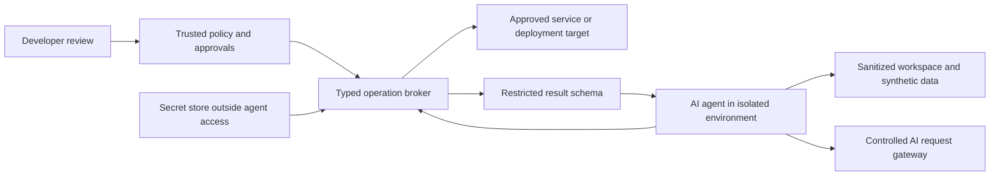

# SoterAI: honest secret-protection audit and roadmap

Date: 12 November 2026, Asia/Calcutta. Requested scope: current IDE extension, practical usefulness, and protection from development through deployment.

**Snapshot note:** This is the pre-implementation audit. The reproduced forwarding defect has subsequently been fixed in the new P0 candidate; see [implementation results](P0-IMPLEMENTATION-2026-11-12.md). Original observations and their evidence remain unchanged below.

**Verdict:** SoterAI has substantial useful implementation. It is a cooperative, local secret-protection product, not an isolation boundary that prevents an unrestricted AI agent from obtaining secrets. A newly reproduced detector/redactor mismatch also permits a recognized password to pass the configured broker in developer and strict modes. Fix that before expanding the feature list or strengthening protection claims.

**Recommended direction:** Keep Lite useful for accidental exposure prevention. Build a separately verified stronger mode where the AI works in an environment without real secrets and requests narrowly authorized operations from a trusted broker.

## 1. What was actually examined

Three versions must not be confused:

| Object | Observed state | What this establishes |
| --- | --- | --- |
| Default VS Code extensions registry and installed package | `soterai.soterai-ide-guard` 0.6.2, 163 contributed commands | Registered installation in the default VS Code extensions directory. Not proof of activation in the user's current window or every editor/profile. |
| Canonical implementation package | `packages/vscode-extension`, manifest 0.6.3 | Source shared by Lite; not the current Lite release identity. |
| Current Lite candidate | `packages/soterai-lite`, 0.7.0, Windows x64 pre-release | Main subject of the implementation audit. Its entrypoint re-exports the canonical extension implementation. |

Sources: [Lite manifest](../../packages/soterai-lite/package.json), [Lite entrypoint](../../packages/soterai-lite/src/extension.ts), [build script](../../packages/soterai-lite/scripts/build.cjs), [current status](CURRENT-STATUS.md). Paths in this document are relative to `docs/soterai-lite`; repository references below use `../../`.

The retained candidate exists and its hash was freshly checked:

`7ebe91420024516e4a55c1afe123f32e6defa40208971cf023a7bfae4a2045dd`, 1,749,209 bytes.

It is the candidate in `.worktrees/soterai-lite-escaped-20261110/packages/soterai-lite/`. The root `dist/build-receipt.json` refers to an older 8 November build, so root dist is not automatically the same object. Of 853 selected source/test metadata facts compared with the retained qualification, 631 matched exact bytes and 222 differed only by CRLF/LF line endings. No other content difference was found within that selected set. This is source comparison, not a new installed-VSIX execution or complete dependency/bundle equivalence proof. [Hash evidence](audits/2026-11-12/artifact-check.json).

Reviewed areas: manifests and defaults, build/release workflows, detector/redactor decisions, registered matching, gateway request and response flow, safe file views, file-open monitoring, vault process launch, checked terminal design, configuration/history/artifact scanners, setup/coverage UI, privacy and retained verification records. This was a deep targeted audit, not an assertion that every repository file was inspected.

No real `.env` contents, credentials or user secret values were opened for the audit. No provider login, real model request, extension installation, hook installation, production change or publication was performed. Existing working changes were preserved. New files contain the audit, synthetic probe and verification results. Parallel reviewers contributed architecture/product reasoning from supplied excerpts; they had no independent repository access and are not independent security auditors.

## 2. Fresh evidence versus retained evidence

| Verification performed now | Result | Limit |
| --- | --- | --- |
| Six guard-core suites: detector classes, expansion, redaction, safe context, vault and detectors | 63 passed; zero failed/skipped | Selected local tests |
| Eighteen extension suites: registered matching, output handling, gateway schemas/decoders, consent, MCP, child environment, CI/artifact content, command palette | 404 passed; zero failed/skipped | Mostly component tests, not every actual vendor UI route |
| Three Lite release suites | 55 passed; zero failed/skipped | Release helpers and synthetic fixtures; no publication |
| Lite `tsc --noEmit` | Exit 0 | Compiler check, not installed runtime verification |
| New broker probe | 12 synthetic cases executed | Real gateway/scanner callbacks, mocked HTTP objects and provider; no network |
| Candidate SHA-256 and selected source comparison | As above | Does not replace installed-object testing |

**522 selected existing tests passed. That does not mean there are no security defects.** The separate probe below demonstrates one that these selected tests did not catch.

Evidence: [core tests](audits/2026-11-12/core-tests.tap), [extension tests](audits/2026-11-12/extension-tests.tap), [release tests](audits/2026-11-12/release-tests.tap), [probe source](audits/2026-11-12/boundary-probe.cjs), [probe results](audits/2026-11-12/boundary-probe.json).

The 11 November retained summary reports 5,070 passes and four skips, 32 implemented features, selected native/vendor/lifecycle checks, and a 17-case security baseline containing eight scoped blocks and nine unmanaged leaks. Its 264 original scenario/tool cells are graded 1 STRONG, 214 PARTIAL, 5 UNVERIFIED and 44 NOT_COVERED. These are retained project records, not this audit's freshly rerun results. They are not a statistical security success rate. Five self-run profiles are not five independent human testers. [Retained summary](evidence/20261111-queue-completion/final-local-reconciliation-01/summary.json).

## 3. How many features are really useful?

The catalog contains **32 implementation groups**. The candidate manifest has **300 commands and 95 settings**. Commands/settings are not independent useful features. The palette already hides 34 commands and puts 248 behind `soterai.advancedCommands`; 18 lack those palette restrictions. It would be misleading to say users face 300 ordinary palette actions.

My workflow-based classification is **nine directly useful protection groups plus one supporting platform/UX group**. This is an explicit product assessment, not a measured count of independently proven security guarantees.

| Practical group | Catalog mapping | Real user value now | Boundary / improvement needed |
| --- | --- | --- | --- |
| 1. Saved restrictions, policy, exact safe-read consent | F01–F04 | Keep selected files/regions out of supported AI reads; review the exact safe output | Other processes can still read originals. Coverage must identify the actual route. |
| 2. Private masked env editor | F05 | Work with sensitive configuration without showing values by default | An ordinary original buffer remains readable. Masking is not filesystem isolation. |
| 3. Vault migration, recovery and approved app launch | F06, F09 | Replace reviewed source values with placeholders; retain encrypted recovery; let approved apps use selected secrets | Highest-value foundation, but the receiving app possesses the secret. Current launcher is bounded Node `.js/.cjs/.mjs`, with a five-minute runtime cap and lifecycle-only debug integration. |
| 4. Registered-value matching and output filtering | F07–F08 | Match known values and supported encodings; withhold unsafe completed output | Not arbitrary transformation or cross-request protection. Output filtering cannot recall a prior upload. |
| 5. Checked terminals | F10–F13 | Safer bounded commands and reviewed reads in PS5.1, PS7, cmd and Git Bash | Declared grammar only. This is not unrestricted shell command coverage. |
| 6. Owned broker and provider gateway | F14–F16 | Inspect configured AI request bodies before forwarding; fail closed on unsupported input within the route | Strong useful control, but affected by the confirmed password bug and bypassed by independent traffic. |
| 7. Managed safe-read MCP and pinned agent adapters | F17–F20 | Connect applicable Cline, Claude Code, Codex IDE/CLI and Gemini routes | Pinning/configuration does not prove every search, attachment, context, terminal or upload path is mediated. |
| 8. Hygiene, config, history, artifacts and logs | F21–F25 | Find earlier copies and release risks in source, CI, Docker/Kubernetes, Terraform, registries, service accounts, Git, bundles/source maps and logs | Mostly bounded static analysis. Finding a risk is not enforcing a cloud deployment. Replacement markers can require manual runtime/CI changes. |
| 9. Optional Git and history hooks | F26 | Additional commit/push/history checkpoints | Defaults are off. Local hooks can be bypassed or absent. Need server/CI controls too. |
| 10. Self-hygiene, reliability, Protection Center, setup verification, packaging and recovery | F27–F32 | Essential support for a usable and recoverable security product | Do not count every check or lifecycle operation as a separate leak-prevention boundary. Human acceptance remains incomplete. |

All F01–F32 rows are marked DONE in the retained queue, with several explicitly PASS_SCOPED. That describes their implementation and declared evidence, not universal coverage. [Feature queue](FEATURE-QUEUE.json).

Relevant implementation: [safe reads](../../packages/vscode-extension/src/project-privacy/ProjectFileAccess.ts), [safe views](../../packages/vscode-extension/src/project-privacy/SafeFileView.ts), [vault runtime](../../packages/vscode-extension/src/vault-runtime/VaultAppJob.ts), [runtime limits](../../packages/core/src/VaultAppDescriptor.ts), [matcher](../../packages/core/src/RegisteredSecretMatcher.ts), [output redactor](../../packages/core/src/StreamingOutputRedactor.ts), [gateway](../../apps/local-ai-broker/src/GatewayPolicy.ts), [hygiene controller](../../packages/vscode-extension/src/hygiene/HygieneController.ts).

The best existing foundation is **vault/placeholders + safe reads + managed gateway + release reviews**. Do not rebuild those as supposedly missing features. Connect and harden them. Prompt-injection scores, AI-generated-code warnings, dependency heuristics and canaries can help, but should not distract from the secret custody and forwarding boundary. A canary detected after AI output is evidence of exposure, not prevention of the first disclosure.

## 4. Findings in priority order

### P0: recognized prefixed password reaches the configured broker's provider callback

**Severity: High confidentiality impact in the reproduced route.** This is a security defect, distinct from an explicitly unmanaged route.

Synthetic reproduction: an unregistered `DB_PASSWORD=BlueMango7!` is recognized as `password_assignment`. The broker reports `warn`, `redacted: false`, `safe: true`. In default developer mode and strict mode, the actual `GatewayPolicy.proxy` path forwards the unchanged value to the mock provider.

Root cause:

- `SecretDetector.ts:264` recognizes prefixed key names through `KEY_PREFIX`.
- `Redactor.ts:95` retains a bare-word assignment regex; it does not cover the same prefixed key grammar.
- `RegisteredSecretMatcher.ts:22` deliberately omits `password_assignment` from its provider-pattern fallback.
- The generic entropy fallback at `RegisteredSecretMatcher.ts:274` requires a much longer value.
- `BrokerScanner.ts:126` uses the incomplete redactor, and survivor checks do not catch this class. `BrokerServer.ts:241` and the gateway forwarding path consequently permit it.

Controls localize the defect: unprefixed `password=` is redacted; registering the exact value blocks it; an ordinary public request passes. Enterprise mode without approval withholds the request. An approved enterprise request was not tested; do not assume approval repairs redaction.

**Required fix:** make detected, policy-sensitive spans and final outbound redaction agree. Strict mode must block or forward a verified sanitized payload. It must never equate `warn + unchanged detected secret` with safe forwarding. Add end-to-end broker tests for prefixed names, case, quoting, whitespace, JSON/YAML text, multiple matches and approved enterprise requests. Values must stay below the entropy threshold so that another detector does not accidentally hide this regression.

This is not a claim that a real provider received credentials, that every password leaks, or that the installed 0.6.2 binary was tested. The reproduction uses current source and a mocked provider callback. The relevant gateway, matcher and detector source files match the retained source qualification exactly.

### P0/P1: release identity and automated workflow paths disagree

Root `vscode:package` builds `packages/soterai-lite`. However:

- `cross-ide-release.yml:159` invokes the legacy verifier and `:165` collects `packages/vscode-extension/*.vsix`.
- `signed-release.yml:76` reads the legacy manifest version, `:83` hashes from the legacy directory, and `:95` uploads legacy VSIX paths.
- `verify-vsix.mjs:11` defaults to the legacy manifest's name/version.

The current generator writes uniquely named Lite artifacts under `packages/soterai-lite` (`package.cjs:41`). This is a confirmed static workflow mismatch; no hosted CI execution was run here. A clean runner can fail, and a reused/stale artifact directory could lead to verification of the wrong object.

Use one package receipt as the source for identity, version, artifact path, hashes, verification, signing and upload. Run native acceptance on that exact Windows candidate. Also make dependency rebuilding explicit: the package exports for guard-core point at `dist`, while this audit's root `tsx` execution resolves guard-core to source. A passing source test cannot by itself establish what an older generated bundle contains.

### Architecture limit: same-user original reads and independent uploads

`SecretFileInterceptor.ts:7` explicitly explains that `onDidOpenTextDocument` is after access and is not an awaitable interception point. The callback at `:45` observes opening; it cannot veto another extension's earlier read. `FileReadSentinel.ts` records context about active tools, not proof of the calling extension.

A same-user agent can read accessible originals, backups, history or other extension buffers using its own APIs. Ignore files are cooperative instructions. A configured gateway only inspects traffic that traverses it. Microsoft's extension runtime documentation confirms extensions can read/write files, make network requests and run processes with VS Code's permissions.

Removing known values from agent-visible files helps substantially. It still does not establish isolation from decrypted vault memory, receiving processes or earlier copies. Full hostile-agent protection requires a separate access-control boundary.

### Architecture limit: an approved application receives real secrets

`VaultAppJob.ts:43` assigns approved values into the child process environment, then loads the selected entrypoint. The source already says this is not a process sandbox. Program digest checks and scrubbed environment are valuable, but an authorized application, its dependencies or mutable inputs can print, store or transmit received values.

If AI can modify the code that receives production credentials, launch approval alone is insufficient. Default development should use mocks, synthetic data or narrowly scoped test identities. Sensitive operations should be implemented by a trusted service with typed operations. Where raw secrets must reach an application, make the trusted-code assumption explicit.

### Declared limits: transformations, request boundaries and short values

The probe confirms that a registered value in raw and base64 form is blocked. Its reversed representation passes. Each half in a separate independent request also passes. The matcher is explicitly request-local and does not claim arbitrary decoding. These are security-model limitations, not the same detector/redactor regression.

Cross-request tracking can raise suspicion, but cannot prevent a first partial disclosure once it was sent, and cannot cover arbitrary encodings/covert channels. Do not solve the architecture problem by accumulating unlimited user prompts or decoding indefinitely.

Registering a value shorter than eight characters causes `GatewayBoundary.ts:151` to withhold even the public control. This is conservative confidentiality behavior with a practical availability cost. Reject unsupported registrations clearly, or define a narrowly tested short-value policy; do not quietly leave the developer with unusable AI traffic.

### Product limit: bounded workflows are narrower than ordinary all-day development

Current request and output limits include 128 KiB, finite chunk/event counts and a one-second inspection budget. Provider SSE is collected before response release (`GatewayPolicy.ts:119`–`:128`). Terminal output is buffered until completion (`StreamingOutputRedactor.ts:15`). The vault app descriptor permits Node entrypoints and a maximum five-minute run.

These are deliberate controls, but long conversations, large tool schemas, long-running dev servers and streaming expectations need real usability measurement. Raising limits without memory/CPU and secret-release tests is not a solution. Keep strict bounded buffering where it is necessary; introduce separately specified safe interactive workflows only after proving their release rules.

### Product gap: static deployment scans are not a deployment enforcement system

The CI scanner states that it does not execute CI, resolve includes, build or deploy. Its markers may interrupt jobs until the owner configures secret loading. Docker/Kubernetes and Terraform scans have similar explicit bounds. The existing CLI supports local broker scanning, hooks and a vault; this is a starting point, not proof of a complete shared CI/deploy policy.

Missing end-to-end product guarantee: a protected, immutable build/deploy flow that keeps production credentials outside agent-written scripts, enforces artifact and policy checks, uses short-lived deployment identity, injects secrets only at the trusted runtime, and releases sanitized diagnostics.

### Evidence and product-copy drift

The README/privacy statement still describes pre-commit native verification as pending; the latest queue/current status says implementation and declared native scope are complete. Release/human acceptance is still incomplete, but these statuses should come from one current evidence source.

The Protection Center correctly avoids universal green claims; its model currently labels the five live tool routes unverified rather than deriving proof from broker uptime. Improve it with real route verification, not optimistic badges. Preserve that honesty. The final score should stay provisional until independent/human acceptance is actually done.

## 5. Desired security contract

Separate three modes:

1. **Observe:** detect and explain potential exposures. No claim to stop every read/send.
2. **Managed Lite:** supported readers, registered secrets, checked execution and configured provider requests obey stated policies. Independent access remains outside coverage.
3. **Isolated workspace:** AI has no access to managed secret stores or original private files and can request only approved credentialed operations. This mode does not exist in the shipped Lite architecture today. `packages/soterai-full/README.md` explicitly calls Full a dependency-only scaffold.

Define secrets by origin and custody, not only recognizable strings. Passwords, private keys, cookies, database URLs, signing material and business/customer data may have no vendor prefix. A detector cannot infer all private information from arbitrary text. User classification, source policy and least privilege remain necessary.

Distinguish the target as well: the AI model must not receive project secrets in prompts/tool results/attachments. A provider API key may legitimately go to its intended authentication endpoint, through a controlled credential path; it must not be inserted into model context. An authorized deployment service necessarily uses credentials. “No secret ever leaves the device” would contradict these legitimate operations unless the product explicitly forbids them.

## 6. Proposed stronger architecture

Required properties:

- Agent identity cannot read the original workspace, host home, `.git` with secret history, credential stores, SSH agent, host IPC or container-management socket. A second process under the same unrestricted user is not enough. Evaluate a properly constrained VM or OS identity boundary on Windows; WSL/container presence alone is not proof.
- Generate an allowlisted sanitized workspace before the first AI session. Reuse existing safe-publication code but extend its bounded export into a verified runnable workflow. Do not claim it discovers every previous copy.
- Keep privileged policy outside agent-writable files. Repository policy may strengthen a baseline but cannot relax it. Review changes through a trusted user interface.
- Expose operations such as `deployApprovedArtifact(project, digest, environment)`, not `getSecret(name)`, unrestricted `run(command, secret)` or arbitrary authenticated HTTP requests.
- Bind approvals to project, environment, resource, artifact digest, policy version, permitted fields and expiry. Validate tenant/resource authorization even on an allowed hostname. Deny unauthorized redirects and credential forwarding.
- Return deployment IDs/status and approved result fields, not raw headers, environment dumps, production logs or arbitrary upstream errors. Credential isolation does not prevent misuse of a privileged broker; prevent that confused-deputy problem explicitly.
- Prevent general agent egress and host escape paths within the declared isolated mode, including IPv6, direct IP, proxies, DNS and localhost routes. Permit the defined model transport and bounded operations. Secret exclusion is the primary control; network policy is additional protection.
- On broker, policy or gateway failure, new protected operations fail closed. Recovery must retain usable encrypted data without automatically revealing plaintext.

A production application that is authorized to read a secret can disclose it if its code is malicious. No IDE extension can honestly promise otherwise. Review immutable code/artifacts, minimize runtime credentials, use workload identity, and move particularly sensitive operations into trusted services.

## 7. Development-to-deployment journey

| Stage | Desired user experience | Enforcement/result |
| --- | --- | --- |
| Project onboarding | Identify AI tool, stack and likely secret locations without showing values | Explain supported/unexamined scope before enabling AI access |
| Secret migration | Review replacement and recovery once; keep placeholders in AI-visible source | Values held outside the agent environment in strong mode |
| Local coding | AI sees API shapes, variable names, fixtures and synthetic data | Production credentials absent from agent-controlled code and shell |
| App/test execution | Use mocks by default; request approved real-service operations when necessary | Narrow test identity or typed broker operation; no broad raw-secret release |
| Git/PR | Reuse local checks plus server-side push protection and protected CI | Bypassing local hooks does not bypass the server/merge policy |
| Build | Build immutable artifacts without production credentials | Scan outputs, source maps, archives and image layers; use trusted ephemeral build-secret mounts only where necessary |
| Deploy | Review exact artifact/environment once | OIDC/workload identity, trusted protected workflow, narrowly scoped target |
| Runtime | Platform provides needed credentials to reviewed code | No deployment credential in client bundle; distinct build/runtime permissions |
| Diagnostics | AI receives a sanitized support bundle | Redact before logs enter AI context or external telemetry |
| Incident | Remove exposed copies and rotate/revoke through provider workflow | Exposure remains recorded as suspected/confirmed; deletion is not revocation |
| Upgrade/removal | Preserve recovery and verify new configuration | No silent raw restore, lost key, or misleading “protected” status |

## 8. Final roadmap

These are estimated engineering phases, not promised delivery dates. Two experienced engineers plus security review could target roughly 12–20 weeks for a Windows-first pilot with one isolated agent and one deployment connector. A solo effort is more plausibly several months; validate the isolation spike before committing to a date. Broader platforms/providers follow measured demand.

| Priority / phase | Concrete work | Reuse / likely ownership | Acceptance gate |
| --- | --- | --- | --- |
| **P0: correctness, 3–7 working days** | Fix detector/redactor mismatch; review all omitted sensitive categories; validate final outbound representation and approved enterprise path | `guard-core/SecretDetector`, `Redactor`, `BrokerScanner`; `core/RegisteredSecretMatcher`; broker tests | Reproduced prefixed-password cases cannot reach mock/loopback provider unredacted in prevention mode; public controls still work |
| **P0: release identity, alongside correctness** | One receipt drives version/path/hash; align workflow verifier/uploader; rebuild dependent packages; reconcile installed/candidate identity and stale docs | Lite build/package scripts, both release workflows, existing lifecycle evidence | Clean build verifies and tests the exact produced Windows VSIX; deliberate wrong-path/version/hash input refuses |
| **P1: usable Lite workflow, 2–3 weeks** | Integrate existing inventory, env editor, vault, safe context, app launch and route verification into one onboarding journey; explain short-value and runtime limits | Existing Protection Center, setup verification, vault and adapters | New user can protect a small real project, run a supported app and prove the selected AI route without maintainer help |
| **P1: meaningful coverage and detector quality** | Per-tool/version/route proof; no badge from uptime alone; realistic held-out secret/benign corpus; scoped suppression with expiry | Setup/coverage model, matcher and detectors | Every claimed route has a failing-secret test and passing useful public control; scan omissions are visible |
| **P2: isolation feasibility, first 1–2 weeks of a 4–8 week track** | Prototype one Windows isolation mechanism and sanitized runnable workspace; evaluate IPC, filesystem, network and lifecycle boundaries | Full scaffold; existing public-workspace publication as input preparation | Direct agent reads, host-home mounts, alternate paths and unmanaged egress are unavailable; developer workflow remains useful |
| **P2: trusted operation broker** | Separate custody from AI principal; one typed operation/connector; resource authorization, immutable approval, minimal result schemas | New Full broker/custody modules with shared policy contracts | Agent gets useful operation result without secret value; endpoint/resource substitution, replay and artifact mutation refuse |
| **P3: CLI and CI parity, 3–5 weeks, partly parallel** | Extend existing CLI for deterministic headless scans using the same policy; redacted JSON/SARIF; CI templates; server-side controls; source/artifact distinction | `packages/soterai-cli`, shared scanners, protected workflow templates | Clean and seeded repositories produce consistent IDE/CLI/CI decisions; CI cannot claim clean when scan is incomplete |
| **P3: one deploy and runtime integration** | Secret-free builds; OIDC; approved artifact deployment; platform-native runtime references; sanitized diagnostics and rotation state | One selected cloud/CI connector; hygiene and artifact scanner reuse | Demonstrate coding→PR→build→deploy→diagnose with zero managed canaries in captured AI requests/tool outputs or public artifacts |
| **P4: adversarial pilot, 2–4 weeks** | Independent review, actual users, screen-reader checks, interruption/recovery drills, target-hardware performance, maintainer update process | Existing tests/evidence plus real external participants | Critical/high in-scope defects resolved; evidence distinguishes current run, retained run and untested route; small pre-release cohort succeeds |
| **Later** | More agents, operating systems, language runtimes and secret managers | Only after the first workflow is stable | Each addition gets its own compatibility and isolation evidence |

**Next implementation PR should fix the recognized-password forwarding defect.** Follow with the artifact/CI identity mismatch. Do not begin by adding more scanner categories, shells, dashboards or a cloud LLM classifier.

For that first PR, add a regression beside `gatewayPolicyWire.test.ts` using a provider collector. Cover `DB_PASSWORD`, other supported prefixes, quoting/whitespace/case, nested supported messages/tool results, multi-match bodies, unregistered/registered values, strict/default/enterprise-with-approval, parsing failure and benign controls. Prefer shared spans/structured locations over maintaining divergent regex grammars. Verify the final serialized outbound body. Preserve metadata-only diagnostics. Then run the same regression against the produced VSIX in a supported host.

## 9. Release and usefulness measurements

Proposed targets below are acceptance targets, not measurements already achieved:

- Zero managed synthetic secret disclosures in every claimed route of the maintained adversarial suite. Report unsupported routes separately; zero observed leaks is not a proof against all attacks.
- At least five independent developers complete onboarding, normal work, one finding/remediation and recovery. Target four of five completing the supported setup in ten minutes without maintainer intervention; investigate failures rather than replacing testers.
- Report precision and missed-secret rate on a held-out corpus, broken down by registered secrets, vendor patterns, contextual passwords and benign examples. Never label test pass percentage as detector accuracy.
- Measure p50/p95 scan overhead, peak memory, request size limits and time to first useful response on named Windows hardware. Initial budget proposal: under 100 ms p95 for a representative 64 KiB local scan; confirm or revise after benchmarking. Provider time must be separated from gateway overhead.
- Route compatibility binds tool version, provider protocol, settings, runtime/artifact hash and last verification. Stale proof changes status to unverified.
- Interrupted migration/upgrade/removal retains recovery; no silent disclosure or overwrite. Validate the current installed upgrade path, not only a synthetic fresh profile.
- Dependency advisories distinguish build tooling from shipped runtime reachability. SBOM/inventory generation is not a fresh vulnerability audit. This audit did not query an advisory database.
- Logs, SARIF, support exports and crash/error paths must be checked with canaries. Use keyed identifiers where correlation is needed; avoid exposing weak-secret hashes or raw snippets as “redacted” evidence.

High-value adversarial cases: original filesystem read; another extension's buffer; `.git`/backup/cache copies; symlink/junction/hardlink/UNC/alternate-stream routes; edited runtime dependency after approval; agent code printing its environment; direct/provider-fallback egress; fragmented/encoded content; secret-bearing image/file attachments; broker crash; stale policy; wrong tenant/resource; unsafe redirect; sensitive upstream error; changed deploy artifact; compromised CI workflow; provider login/version drift.

## 10. External research actually consulted

Fetched public primary sources during this audit:

1. [Microsoft: extension runtime security](https://code.visualstudio.com/docs/configure/extensions/extension-runtime-security) — extension host has VS Code's permissions; extensions can access files, network and processes. Supports the limit of an IDE-only boundary.
2. [GitHub Actions: OpenID Connect](https://docs.github.com/en/actions/concepts/security/openid-connect) — workflows exchange short-lived tokens with cloud providers. Supports reducing persistent deployment credentials; trust conditions and least privilege are still required.
3. [GitHub: push protection](https://docs.github.com/en/code-security/concepts/secret-security/push-protection) and [secret scanning](https://docs.github.com/en/code-security/concepts/secret-security/secret-scanning) — repository-side secret prevention/detection with scope and bypass behavior. Availability/configuration must be checked for the target account.
4. [Docker: build secrets](https://docs.docker.com/build/building/secrets/) — do not use build ARG/ENV as secret transport; use secret/SSH mounts when credentialed builds are necessary. A malicious build step that can read a mount can still disclose it.
5. [OWASP Secrets Management Cheat Sheet, official source](https://raw.githubusercontent.com/OWASP/CheatSheetSeries/master/cheatsheets/Secrets_Management_Cheat_Sheet.md) — least privilege, automation, lifecycle/rotation and environment exposure. The rendered website returned HTTP 403; the official repository source was fetched successfully.
6. [MCP security best practices, current draft](https://modelcontextprotocol.io/docs/draft/tutorials/security/security_best_practices) — confused deputy, token passthrough, SSRF and local MCP process risks. Draft guidance must not be treated as a frozen protocol guarantee.

The Claude hooks page returned HTTP 403. The requested OpenAI Codex security URL redirected to a broader documentation page; it was not used to assert a specific current hook/sandbox contract. Vendor compatibility claims here come from the inspected pinned repository implementation and its stated limits, not invented live-provider testing.

**Product promise worth building:** “Your AI works with safe project context and can complete approved development/deployment operations without being given your managed secret values.” Publish that stronger claim only for the isolated routes that have actually earned it. Today's Lite should promise scoped accidental-exposure protection, with the forwarding defect fixed and unsupported paths clearly shown.
