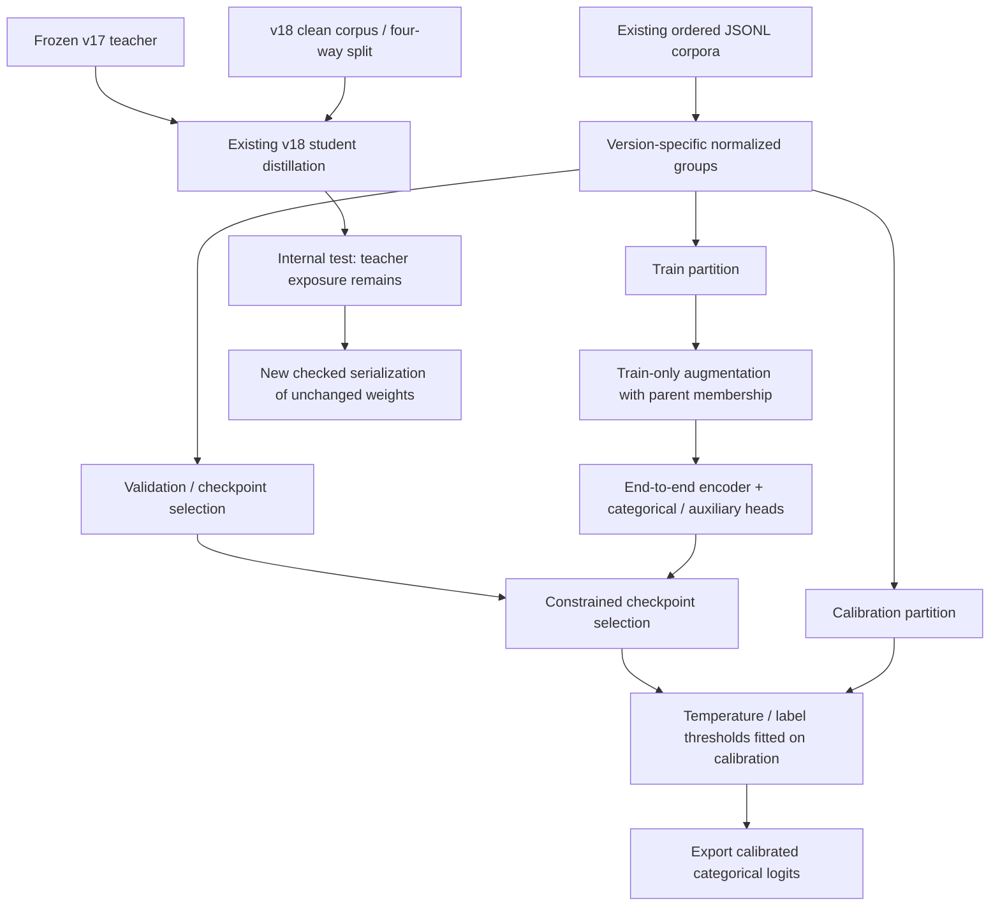

# Soter v-final — Phase 1: recon and reproduction

**Status:** Phase 1 remains open. The historical second input-integrity cycle passed 20/20 genuine tests, but its exact-hash review failed on lifecycle/final-status concerns. The user-approved **one additional manual cycle** (`deleg_f680a3e7`) has now completed five recorded sequential RED→GREEN slices. The parent verified 47 child evidence-file fingerprints, all seven original metadata pins and unchanged original test/safety-function ASTs, then freshly passed **26/26 tiny-fixture tests** and **1/1 genuine saved-model test** in separate native runs (both exit 0, exact collected/started/passed IDs agree). The earlier separate runs verified 27/28 cases. A fresh unchanged **28/28-case full recovery suite now passed**, including both genuine saved-model loading and genuine CLI export/parity/source-preservation, native and parent exit 0; collected/expected/started/passed testcase IDs match exactly, no skips/errors/failures. The original checkpoint SHA256 stayed `166733d6004519b3548098cf53b51f649cf46e1b918f1013f2a886d1dfc9059f`, reviewed source hashes remained unchanged, and no new private snapshot/output directories remained after the run. Full-suite evidence: `v18-recovered/evidence/parent-fast-genuine-full-20261103T150649Z/full-suite-verification.json`. Passing these existing tests does not resolve the three new independent-review blockers. The ordinary PyTorch mmap probe did not reproduce a deletion lock; the confirmed regressions use explicitly labelled real Windows deny-delete consumers and cleanup/publication fault injection. Latest-source exact-hash independent review `deleg_70f01cd0` **FAILED** (one security / two logic blockers): failure recording can contaminate another invocation's exclusively created output (`recover_export.py:503`); `load_state` cleanup can mask a primary SHA256 rejection (`:224`); wrapping final-publication I/O errors drops failure-record refusal notes from the printed diagnostic (`:507`). Its full-scope verdict and parent-matched hashes are preserved in `independent-review-deleg_70f01cd0.json`; these new findings have not been claimed as reproduced RED tests. No further recovery source-fix cycle is authorized. The earlier resource block at `2026-11-03T09:23:48.842296+00:00` is retained as history. Fresh preflight at `2026-11-03T15:06:49.545693+00:00` measured **5,770,506,240 free disk bytes / 7,007,584,256 available RAM bytes**, above the genuine export's **933,930,572 initial free bytes** and the caller's conservative 5-GiB RAM floor; the genuine full suite was executed without bypassing the real guard or cleanup authorization. Ruff reports **17 baseline / 18 current findings**, with one new test-diagnostic `BLE001`; no lint-clean claim is made. Evidence: `v18-recovered/evidence/parent-manual-cycle1-20261103T091440Z-1af535/parent-verification-latest.json`. Further recovery source fixes require a new user decision; this manual cycle does not reset the exhausted two automatic cycles. No original model/metadata or existing recovered-bundle writes, cache deletion, process termination, training, deployment or git mutation were performed by this cycle. Phase 2 runs in separate owned scopes. This is not the nine-phase FINAL REPORT.

## 1. Deployment information still needed — one consolidated block

The offline evaluation can continue without these answers. Before the real serving release gate, please provide:

1. Production hardware/instance type: CPU, allocated cores, RAM, and GPU if any.
2. Deployed build/artifact identity and active settings: model digest/path, ML/judge modes, maximum sequence length, windowing and any artifact-size override. Do not send credentials or secrets.
3. The hard latency SLO and workload: whether p95 is model-only, server-only or end-to-end; typical/maximum request size and realistic concurrency.

T4 free-tier Colab remains the training floor specified in the request. Existing local weights were found; their remote Drive/HF checkpoint locations and production identity are not established by this checkout.

## 2. What I did

- Inventoried **18 primary model-artifact directories**, four additional legacy-worktree locations, one metadata-only int8 experiment, and one recovered serialization: **24 locations**, not 24 independent trained models. See `MODEL_ARTIFACT_LOCATIONS.csv`.
- Mapped the model/tokenizer/training/calibration path and cloud/local n8n, IDE and browser integration seams.
- Replayed the exact saved v14 and v17 validation partitions: **36,129 validation predictions** in total. Verified source-file counts, index arrays and per-label supports before inference.
- Ran six intact comparison arms on identical 274-row diagnostic input, common gate, batch/threads and CPU runtime. No thresholds were fitted on these rows.
- Recovered v18 into a NEW directory, with strict weights-only state loading, raw metadata fingerprints, unchanged-tensor verification, ONNX checking and CPU parity.
- Reproduced the effective-whitelist conflict and repeated-PII redaction bug. They are intentionally still regression failures; production fixes belong after the evaluation harness.

### Repository identity

The inspected working branch is `soterai-lite-f22h-resume-20261023`, HEAD `0affcdd0a46ff0e5d6921b69356303b7dd6d22b4`, **not main**. At the recorded remote-tree snapshot, 305 of 306 tracked files under `lib/guard`, `lib/ml` and `scripts/ml` matched main `3c93573ea9daf71bb8ff75615b8c2fd092f10057`; the recorded exception was the pre-existing `mcpToolPoisoningDetector.ts` edit. No checkout/reset was performed.[1]

Public health snapshots reported HTTP 200, ML mode `enforce`, status `healthy`, and `enforcing:true`. They do not disclose the model digest, sequence/window settings or production hardware, so they do not verify that production uses the local v14 artifact.[2][3] Evidence: `artifacts/ml/v-final/phase1/public_health_probe.json`.

## 3. Architecture and version lineage

| Arm | Base / encoder | Blocks / hidden | Reported trainable parameters | ONNX initializer elements | Complete model MiB | Change |
|---|---|---|---:|---:|---:|---|
| v14 | all-MiniLM-L6-v2 | 6 / 384 | 23,096,975 | 22,899,726 | 87.52 | End-to-end MiniLM baseline; historical Latin-only split key. |
| v15 | all-MiniLM-L6-v2 | 6 / 384 | 23,096,975 | 22,899,726 | 87.52 | Adds 1,155 threat rows; Unicode-aware grouping changes the split. |
| v16 | all-MiniLM-L6-v2 | 6 / 384 | 23,096,975 | 22,899,726 | 87.52 | Adds 4,100 threat rows; stored selected checkpoint is epoch 2. |
| v17-minilm | all-MiniLM-L6-v2 | 6 / 384 | 23,096,975 | 22,899,726 | 87.52 | Same MiniLM architecture on the expanded v17 corpus. |
| v17-multilingual | multilingual DistilBERT | 6 / 768 | 135,364,367 | 135,265,806 | 516.15 | Multilingual cased tokenizer, wider DistilBERT encoder. |
| v18-recovered | multilingual DistilBERT | 3 / 384 | 51,810,575 | 51,761,678 | 198.33 | Existing 3-layer distilled student; serialization repaired only. |

Parameter totals in the table are **recorded trainable counts**, not a fresh claim that every parameter receives gradients. ONNX initializer counts also include non-learned buffers. Complete model sizes include referenced external weight files, not only the ONNX header.

Evidence: `models/<directory>/training_stats.json`, `dataset_manifest.json`, `labels.json`; `artifacts/ml/v-final/phase1/artifact_sizes_verified.json`; `scripts/ml/train-soterllm-v14-fullft.py:264–331`.

### Classifier contract

This is a transformer encoder classifier, not an autoregressive chat model: mask-aware mean pooling → LayerNorm → MLP `hidden → 512 → 256 → 14`. The auxiliary binary attack head is trained but dropped by the ONNX wrapper. No span-localization head is exported. Calibration temperature is baked into logits exactly once. MiniLM uses uncased 30,522-entry WordPiece; multilingual variants use cased 119,547-entry WordPiece.

Exact index order (`models/ml-classifier-v14/labels.json:2–15`):

```text
0 SAFE
1 PROMPT_INJECTION
2 JAILBREAK
3 SYSTEM_PROMPT_LEAK_ATTEMPT
4 PII
5 SECRET
6 UNSAFE_OUTPUT
7 RAG_POISONING
8 DATA_EXFILTRATION_ATTEMPT
9 TOOL_CALL_ABUSE
10 ENCODING_OBFUSCATION
11 MULTI_TURN_ESCALATION
12 MODEL_EXTRACTION
13 TOXICITY_HARASSMENT
```

### Earlier and non-release artifacts

`MODEL_LINEAGE.csv` preserves all 18 primary directory entries, including v2/v3/v4/v7 nine-class ancestors, four smoke runs, two weight-only backups and `_v6_extract`. v7 is recorded as a recovered v4-shaped artifact; the v8–v12 transfer recipes freeze that encoder, while v14 trains the encoder end to end. Standalone recipes are not assumed equivalent just because their version names overlap.

`artifacts/ml/v17-int8` contains metadata/tokenizer files but no ONNX model; it is not a benchmarked int8 candidate. The two original v18 directories have the same valid PyTorch weight hash but broken ONNX artifacts; the new recovered directory is not a new learned version. Duplicate worktree locations are listed separately and are not independent models.

Several v15/v16/v17 statistics say `product_version:"v14"`, and v7 says `"v4"`. These values are preserved, not silently corrected. Artifact directory, topology, label map, manifest and content hashes jointly identify an arm.

### Serving architecture

```mermaid
flowchart LR
    Client[n8n / SDK client] --> Auth[API-key authentication + rate/quota checks]
    Auth --> Parse[Bounded JSON + request schema]
    Parse --> PolicyLoad[Load trusted project policy]
    PolicyLoad --> Rules[Rules + deterministic feature-hash semantic tier]
    Rules --> ML[Optional ONNX augmentation]
    ML --> Judge[Optional LLM judge]
    Judge --> Policy[applyPolicy recomputes final action]
    Policy --> Stateful[Session escalation / reputation where configured]
    Stateful --> Persist[Persistence + public projection]
    Persist --> ClientPost[n8n client postprocessing]
    ClientPost --> Restore[Cloud ignored-literal text restoration]
```



Evidence: `app/api/guard/input/route.ts:198–259`, `lib/guard/mlAugment.ts:342–403`, `lib/guard/policy.ts:351–430`, `lib/guard/publicResult.ts:3–5`.

### Training/data flow



Evidence: trainer `:632–732,1541–1579,1697–1775`; v18 `training_stats.json:24–62`; `split_normalizer_provenance.json` and `fresh_fit_overlap_audit.json`. An offline SVG version of both diagrams is in `PHASE1_DIAGRAMS.html`.

## 4. Recorded metrics versus real reproduction

### Exact saved validation partitions, current CPU FP32 inference

| Model | Validation n | Macro F1 recorded → CPU FP32 % | Risk recall recorded → CPU FP32 % | Benign FPR recorded → CPU FP32 % |
|---|---:|---|---|---|
| v14 | 17745 | 94.2113 → 94.2198 | 99.1694 → 99.1694 | 0.6135 → 0.6135 |
| v17-multilingual | 18384 | 97.7667 → 97.7413 | 99.3375 → 99.3295 | 0.9324 → 0.9491 |

These are **different validation sets across versions** and therefore reproduction evidence, not an apples-to-apples generalization ranking. The recorded inference used CUDA/BF16; the fresh replay uses CPU FP32 ONNX. The indices and supports reproduced exactly, but the metric vectors did **not** match to numerical tolerance. All discrepancies are retained in `PHASE1_VALIDATION_REPRODUCTION.csv` and `artifacts/ml/v-final/phase1/full-validation-replay/report.json`.

v14's binary risk recall, risk precision and benign FPR reproduce exactly; its taxonomy metrics differ slightly. v17 has small additional risk/taxonomy discrepancies. **HYPOTHESIS:** execution-precision/backend differences account for these small changes; an original-hardware BF16-vs-FP32 ablation has not been run. No result was edited to equal the recorded JSON.

Calibration ECE, full training history and original-GPU latency are **recorded only / not rerun** here. All other variants' `eval_results.json` values are also recorded validation evidence, not a new common-test comparison.

### Critical split-reproduction discovery

The live Unicode-aware group key produces 128,620 groups and 17,693 validation rows for v14's unchanged 146,757-row corpus, rather than the saved 128,549 groups and 17,745 validation rows. It does not regenerate the saved membership.

The pre-fix key from Git revision `24fd1097c48f84ce4498258ef9156bc3340d864e:scripts/ml/soter_augment.py` reproduces **every saved v14 train/calibration/validation index in exact order**. It collapses 136 non-Latin rows into an empty key. v17 reproduces using the current Unicode-aware key. The first rejected replay was preserved; no stored split or dataset was changed.

Evidence: `split_normalizer_provenance.json`; current `soter_augment.py:256–287`; `full-validation/reconstruction_failure.json`. Future manifests must record the normalization version/code identity, not just a seed.

### Fresh paired diagnostic cohort

| Model | Precision % | Recall % | F1 % | FPR % | Dynamic p50 / p95 / p99 ms | Fixed-256 p95 ms | Model MiB |
|---|---:|---:|---:|---:|---|---:|---:|
| v14 | 92.67 | 74.37 | 82.52 | 38.89 | 18.38 / 36.53 / 58.35 | 92.64 | 87.52 |
| v15 | 92.19 | 74.37 | 82.33 | 41.67 | 16.98 / 36.97 / 58.17 | 85.91 | 87.52 |
| v16 | 90.76 | 70.17 | 79.15 | 47.22 | 17.39 / 38.19 / 60.49 | 90.91 | 87.52 |
| v17-minilm | 91.94 | 71.85 | 80.66 | 41.67 | 17.41 / 39.37 / 60.69 | 85.09 | 87.52 |
| v17-multilingual | 91.18 | 78.15 | 84.16 | 50.00 | 50.76 / 91.38 / 123.04 | 243.59 | 516.15 |
| v18-recovered | 91.19 | 73.95 | 81.67 | 47.22 | 8.62 / 14.56 / 19.27 | 43.61 | 198.33 |

**Definition and limits:** 238 positive-risk rows (`label != SAFE`, including PII/secrets) and only 36 benign rows from `datasets/v15-test-battery.jsonl`. This is not a prompt-injection-only score or downstream attack-success rate. Gate: binary entropy ≤0.4; common confidence/risk-probability conditions and the same reliable-label set. Rules, semantic veto, tenant policy, API/network, stateful enforcement and LLM judge are excluded. Maximum length 256, batch 16 for scoring; two CPU threads; **80 batch-one timing samples per padding mode**.

Runtime: Windows 11, Intel64 Family 6 Model 142, 8 logical CPUs; Python 3.12.10, ORT CPU 1.27.0, NumPy 2.4.6. Model-only timings include feed allocation/forward/softmax, not tokenization or an API request. p99 with this sample count is diagnostic, not an SLO certification. Source correlation and the tiny benign subset limit confidence. The earlier noisy-host run remains archived separately; it was not relabeled as this cohort.

Evidence: `artifacts/ml/v-final/phase1/recheck-six/report.json` and six score files; `PHASE1_FRESH_RECHECK.csv`. No row or threshold was selected to make a model win.

### Cache and contamination distinctions

The existing 4,000-row three-arm scores were recomputed from stored probabilities. The original model fingerprints were checked, and raw/LF/canonical identifiers were kept distinct; line-ending differences are not silently repaired into a current-inference identity. Those reconstructions remain **historical cached evidence** (`cached_baseline_reproduction.json`, `cached_identity_verification.json`).

Fresh overlap audit against each of the six arms' persisted partitions found **zero exact and current-normalized overlaps** for that battery, with reachable positive controls (200 actual training texts per arm). This does not establish semantic independence or resolve every upstream family/provenance gap.

The archived finding that 3,277 of 4,000 rows occur in a **broader prospective training pool** is a different question; it is not evidence that v14/v17 trained on those rows. New v-final data construction must exclude the evaluation battery from those prospective sources. The older v19 narrative conflates these cases.

For v18's own internal test, **8,152 of 10,238 rows occur exactly in the frozen teacher's training partition**. The teacher weight digest also matches v18's recorded teacher identity. Student-only train/test disjointness therefore does not certify teacher-independent generalization.

Evidence: `fresh_fit_overlap_audit.json`, `artifact_sizes_verified.json`, archived `battery-contamination-2026-10-17.json`. Near-paraphrase/embedding decontamination is not complete.

## 5. v18 recovery — working artifact, not v-final

Original candidate ONNX: 142,606,336 bytes and a ModelProto decode failure. Original student ONNX and tokenizer JSON: zero-byte files. Both PyTorch copies have the same valid 207,268,243-byte weights, 68 tensors and 51,810,575 elements.

Recovered bundle:

```text
artifacts/ml/v-final/phase1/v18-recovered/verified-cpu-fp32/
  model.onnx
  model.onnx.data
  encoder_config.json
  labels.json
  calibration.json
  tokenizer_config/
  training_stats.json
  recovery_manifest.json
```

- Source weight SHA256: `166733d6004519b3548098cf53b51f649cf46e1b918f1013f2a886d1dfc9059f`.
- Strict `weights_only=True`, CPU/mmap loading and exact tensor equality; metadata that controls topology/tokenization/calibration is fingerprint-pinned.
- Four actual PyTorch/ORT parity cases: batch 1 and 2, short/varied lengths and fixed 256 padding. Worst max absolute logit difference: `4.76837158203125e-06`; class argmax agrees.
- Installed Node ORT 1.21.1 also loads the opset-20 bundle and returns finite `[1,14]` logits for its direct tensor-contract probe. This is not a live server/supply-chain acceptance test.
- Historical recovery verification: the original nine-test run passed; optional-input and public-digest fixes then passed **13/13 genuine tests** (exit 0, 162.158 seconds). The next review found verification/consumption/copy races; private verified snapshots and captured sidecars passed **20/20 genuine tests** before the later lifecycle review failed. Those exports/parity logs are historical evidence, not latest-source export verification. Their source hashes and complete original checkpoint/bundle checks remain archived; original broken artifacts and the existing recovered bundle were not replaced.
- The authorized manual lifecycle cycle releases finished traceback consumers before required cleanup, preserves primary diagnostics on persistent cleanup rejection and publishes final success only after required cleanup. Latest source SHA256s are `2f278ab79a10991b814869323944dc335a2fecc75193b5b28d83f2b803f9be3b` (`recover_export.py`) and `c02979f74ceaddc59197f7d2bec2685aa46ded4eee274ef3719d318d8c9bcde6` (`test_recover_export.py`). Fresh parent tiny/native and genuine model-load tests passed on these exact hashes; the consumed original checkpoint hash and seven metadata pins still match, and no new private snapshot directory remained after either run. Fresh genuine export and exact-hash independent review are still required. The first model-only attempt was correctly resource-blocked; a second measured preflight permitted its real passing run. Upstream warnings and all rejected/blocked attempts remain visible in evidence.
- All recovered-file hashes and the original source weight hash were read back and verified. Complete model size is **198.33 MiB**, not the 875,137-byte header.

`release_ready:false` remains in the manifest. The artifact is unsigned for production, does not claim stronger accuracy, and was not connected to a live serving path. Original broken files were left untouched.

## 6. Key product findings and next checks

| Finding | Evidence | Status / implication |
|---|---|---|
| Cloud whitelist restores text but leaves effective PII risk/decision | `tools/v-final/tests/pii-ignore-boundary.test.mts`, `pii-ignore-boundary-verified.json`; n8n `execute.ts:1972–1980,2042–2048,3603–3653` | Reproduced through real client postprocessing with mocked HTTP transport; not a live API/model result. Train changes alone cannot supply missing policy information. |
| Repeated identical PII is only partly redacted | Actual synchronous `runInputGuard` assertion; `detectors/helpers.ts:89–107` deduplicates by matched value, not offset | Reproduced: the second `jane@example.com` remains. Requires occurrence-complete localization/redaction, with scoring behavior checked separately. |
| Caller exception fields are absent in API schemas | `lib/validations.ts:38–62`; cloud payload above | Source-supported. Trusted policy exceptions must be reconciled before final effective action, without waiving other PII, secrets or injection. |
| ML/judge review ceiling can be changed by later policy recomputation | `mlAugment.ts:342–403`, `policy.ts:351–430` | Code-supported risk; real final-action regressions still need harness cases. |
| v15/v16 are not wider/heavier than v14 | Same six blocks, hidden 384 and 91,774,954 model bytes | Measured architecture/size fact. **HYPOTHESIS:** reported latency problems arise in configuration, routing, host load or full serving behavior; production profiling remains necessary. |
| Full v17 exceeds the default artifact limit | 541,224,554 bytes versus 536,870,912-byte default; `onnxBackend.ts:350–353` | The default gate rejects it; deployment overrides are unknown. Do not silently raise the production cap to make a benchmark pass. |
| Default model sequence limit can be 128 although trained limit is 256 | `onnxBackend.ts:280–315`; constructor-only `runtime_defaults_probe.json` | Source/probe fact when the override is unset, not verified production config. Default sliding-window mode is off. |
| Dynamic padding is present now | `onnxBackend.ts:481–486` | The old claim that it is never implemented is stale for this checkout. Capped windowing still does not certify full long-context coverage. |
| Several per-label thresholds are inert | `calibration.json` audits; trainer `:1042–1089` | Recorded/source fact. One-vs-rest target FPR is not a global benign-FPR guarantee. Tune only on proper validation/calibration. |
| Artifact/consumer seams differ | Model/label paths resolve separately; IDE uses guard-core; universal/streaming/MCP paths do not all invoke these augmenters | Source-supported integration risks, not live deployment findings. Final benchmarks must run the actual named consumer path. |

Sensitive-data values in these demonstrations are offline fixtures. No real guard requests, traffic load, credentials or project policy rows were used.

## 7. Artifacts and decision

### Report / tables

- `docs/v-final/PHASE1_REPORT.md` — this report.
- `docs/v-final/PHASE1_DIAGRAMS.html` — self-contained offline SVG diagrams.
- `docs/v-final/MODEL_LINEAGE.csv` — preserved primary inventory.
- `docs/v-final/MODEL_ARTIFACT_LOCATIONS.csv` — all 24 located artifact/metadata locations, roles distinguished.
- `docs/v-final/PHASE1_VALIDATION_REPRODUCTION.csv` — recorded-versus-measured deltas.
- `docs/v-final/PHASE1_FRESH_RECHECK.csv` — latest common six-arm cohort, complete model bytes.
- `docs/v-final/REPRODUCE_PHASE1.md` — exact tools/commands and executed reconstruction code.

### Code / machine-readable evidence

- `tools/v-final/recover_export.py`, `tools/v-final/tests/test_recover_export.py`.
- `tools/v-final/tests/pii-ignore-boundary.test.mts` — intentional known-regression RED, outside recovery green tests.
- `artifacts/ml/v-final/phase1/full-validation-replay/` — saved validation scores and reproduced metrics.
- `artifacts/ml/v-final/phase1/recheck-six/` — six independently fingerprinted fresh score caches.
- `artifacts/ml/v-final/phase1/split_normalizer_provenance.json`, `fresh_fit_overlap_audit.json`, `artifact_sizes_verified.json`.
- `artifacts/ml/v-final/phase1/v18-recovered/verified-cpu-fp32/` and `v18-recovered/evidence/`.

**Decision:** do not promote v17 or recovered v18 on these measurements. The recovered student demonstrates an efficiency point, but does not beat both v14 and v17 on the measured diagnostic quality axes, and its internal test is teacher-exposed. No `v-final` winner exists yet.

**Next stage:** Phase 2 must establish the reusable, leakage-aware multi-slice harness and policy outcome tests before model/threshold changes. Full multilingual benign coverage, 4k–32k context, reasoning-heavy cases, public-benchmark licences, GPU/real-server timings, three-seed training, confidence/significance and release gates are **not completed** in Phase 1. Later phases remain explicit pending work; they have not been silently skipped.

## Sources

[1] https://api.github.com/repos/yashchauhan66/Soter-AI/commits/main — Soter-AI main commit observed during recon
[2] https://api.soterai.in/api/health — Public Soter API health
[3] https://soterai.in/api/health — Public Soter web health
