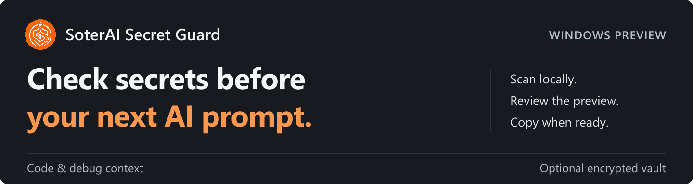

# SoterAI Secret Guard

**Review your code before it becomes an AI prompt.**

SoterAI checks code and logs locally for recognized secrets, then helps you review redacted text before pasting it into an AI assistant. Optional vault workflows replace approved values in saved files with placeholders and retain encrypted recovery.

**[Install in VS Code](https://marketplace.visualstudio.com/items?itemName=soterai.soterai-ide-guard)** · **[Open VSX](https://open-vsx.org/extension/soterai/soterai-ide-guard)** · [Quick start](#quick-start) · [User guide](https://github.com/yashchauhan66/Soter-AI/blob/main/packages/soterai-lite/USER-GUIDE.md)

**Windows x64 · VS Code 1.85 or later · 0.7.0 preview**

Local scanning needs no SoterAI account. This preview is still undergoing release verification; installation does not automatically protect other AI tools.

## Install

### VS Code

Open the [Marketplace listing](https://marketplace.visualstudio.com/items?itemName=soterai.soterai-ide-guard) and choose **Install Pre-Release** when available. Or run:

```sh
code --install-extension soterai.soterai-ide-guard --pre-release
```

### Open VSX or a preview VSIX

Use the [Open VSX listing](https://open-vsx.org/extension/soterai/soterai-ide-guard) in an editor that supports that registry. A compatible registry does not establish that the editor itself is supported.

If you received the preview package directly from the maintainer, open the Command Palette and choose **Extensions: Install from VSIX...**, then select that `.vsix` file. Only install a package from a source you trust.

> **Check the version after installing.** This page describes the 0.7.0 preview. Registry links may serve an older version until the maintainer publishes this candidate. If the preview is unavailable, use a maintainer-provided VSIX rather than assuming the registry version has these features.

[Installation details and updates →](https://github.com/yashchauhan66/Soter-AI/blob/main/packages/soterai-lite/USER-GUIDE.md#installation-and-updates)

## Quick start

1. **Open a local Windows project.** Start with a test folder and synthetic credentials. Trust a workspace only if you trust its contents.
2. **Open the guided setup.** Press `Ctrl+Shift+P` and run `SoterAI: Protect This Project Step by Step`. It offers the next action for your project; opening it does not approve changes.
3. **Try a local check.** Run `SoterAI: Run Safe Demo Scan` for the built-in sample, or `SoterAI: Scan Current File` for the file you have open.
4. **Review before sharing.** On a current live finding, open the lightbulb and choose **Preview sanitized lines before copying**. Inspect the preview, then choose **Copy reviewed text** only if it is suitable to share.

The reviewed-copy action filters recognized secrets in the affected lines. Check the remaining names, paths and private business information yourself. Editing the source or preview requires a new review.

## Choose the workflow you need

| I want to… | Start here |
| --- | --- |
| Ask an AI assistant about selected code | `SoterAI: Prepare Reviewed AI Context` |
| Share a log or stack trace for debugging | `SoterAI: Preview Debug Context from Selection` |
| Describe an environment without its real values | Choose the environment-contract option in **Prepare Reviewed AI Context** |
| Review secrets stored in project files | `SoterAI: Protect Workspace Secrets` |
| Inspect protected items and local check results | `SoterAI: Open Control Panel`, then **Coverage → Verify my setup** |
| Undo owned configuration before uninstalling | `SoterAI: Restore changes before removal` |

You can scan and prepare context without configuring an AI provider. The preview actions above do not send it to an AI service; you choose whether and where to paste it.

[Step-by-step workflows →](https://github.com/yashchauhan66/Soter-AI/blob/main/packages/soterai-lite/USER-GUIDE.md#everyday-workflows)

## Local by default, integrations by choice

Live scanning is enabled by default. Local checks can inspect supported documents and sensitive files without asking before every scan. Vault migration and configuration changes require their own review.

For supported AI tools, optional reviewed adapters and a local gateway can inspect supported traffic routed through SoterAI. Setup depends on the exact supported tool version and configuration.

**The current Coverage view marks live AI-tool routes as Uncovered.** Local checks and a healthy broker do not verify Cline, Claude Code, Codex or Gemini traffic. Verify the actual configured route separately before relying on it.

The documentation distinguishes these route types; they are not automatic passing states in Coverage:

| Route type | What it means |
| --- | --- |
| **Gateway-routed** | Supported requests use the configured managed gateway; actual routing still needs verification. |
| **Vendor-controls-only** | Controls rely on reviewed vendor configuration, not gateway inspection of every request. |
| **Uncovered / NOT_TESTED** | The stated protection has not been established. |

Cline, Claude Code, Codex and Gemini integrations have version-specific requirements. Checked Windows shells, Git/history reviews, isolated Docker tasks and portable vault recovery are optional advanced workflows, not prerequisites for a first scan.

[Integrations, requirements and limits →](https://github.com/yashchauhan66/Soter-AI/blob/main/packages/soterai-lite/USER-GUIDE.md#supported-integrations)

## Know the boundary

- Detection is heuristic. Unknown secrets, unsupported formats and private prose can remain. Always review output before sharing.
- Diagnostics are not interception. Other extensions, direct file reads, unmanaged terminals and independent uploads can bypass the managed routes.
- Configured provider requests go to the provider you select. Dependency-advisory lookups have separate consent. Cloud and telemetry settings do not disable an independently configured provider route.
- Keep recovery records and keys. An application given a secret can still disclose it; redaction cannot undo an earlier upload.
- Linux, macOS, remote and virtual workspaces are not supported by this Windows x64 release. It is not an OS security boundary against other processes running as you.

[Privacy and data handling](https://github.com/yashchauhan66/Soter-AI/blob/main/packages/soterai-lite/PRIVACY.md) · [Recovery and removal](https://github.com/yashchauhan66/Soter-AI/blob/main/packages/soterai-lite/USER-GUIDE.md#recovery-and-removal)

## Documentation and help

| Resource | What you will find |
| --- | --- |
| [User guide](https://github.com/yashchauhan66/Soter-AI/blob/main/packages/soterai-lite/USER-GUIDE.md) | Installation, everyday tasks, settings, integrations and troubleshooting |
| [Privacy](https://github.com/yashchauhan66/Soter-AI/blob/main/packages/soterai-lite/PRIVACY.md) | Local processing, network routes, storage and retention |
| [Changelog](https://github.com/yashchauhan66/Soter-AI/blob/main/packages/soterai-lite/CHANGELOG.md) | What changed in the preview |
| [Report an issue](https://github.com/yashchauhan66/Soter-AI/issues) | Bugs and reproducible problems; include sanitized details only |
| [Product information](https://soterai.in/vscode-ai-security) | SoterAI Secret Guard overview |

**Release status:** this candidate is not release-ready or independently reviewed. Exact-package installed lifecycle checks, real-tool/provider checks and required human evidence remain publication requirements. A passing local self-check is not a coverage score or a universal protection guarantee.

Free local use is subject to the [Business Source License 1.1](https://github.com/yashchauhan66/Soter-AI/blob/main/packages/soterai-lite/LICENSE.md); this is not an OSI-approved open-source license. The package includes third-party notices (`THIRD-PARTY-NOTICES.md`) and an offline software inventory (`SBOM.cdx.json`).
